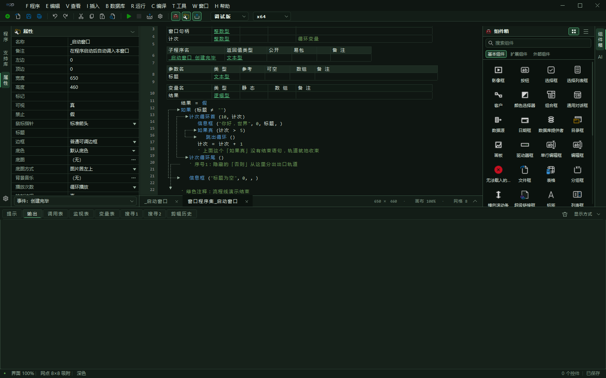

# epp / 易屁屁

用 **C++17 从零自绘**的「易语言」风格 IDE。单文件 29,984 行，只用 Win32 + GDI/GDI+，**零第三方依赖** —— 没有 Qt、没有 Electron、没有 WebView2，也没有任何 UI 框架或外挂资源包。菜单栏、工具条、组件箱、设计器画布、表格式代码编辑器、流程线、属性表、输出面板，全部是像素级手绘。编出来是一个 4.3 MB 的静态 exe。

想做的事很具体：把易语言那套「表格式中文源码 + 网状流程线」的交互，用纯 GDI 复刻一遍，并做成一份能读、能改、能继续长的基础实现。



---

## 现在能做什么

**外壳**
- 深色 / 浅色两套主题令牌（配色、行高、圆角统一走 token），跟随系统或手动切换
- 复刻易语言 5.95 的完整菜单树（10 个顶级、三级下拉、勾选/灰显/快捷键右对齐）
- 可拖放的停靠布局：左栏（程序 / 支持库 / 属性）、底部输出区、右侧组件箱，面板可折叠、可切换页签
- DPI 感知（Per-Monitor V2），4K 屏幕上按 DIP 画

**窗口设计器**
- 网点画布（宽高可分别设置，纯点阵不画网格主线）、拖动实时跟手、松手吸附
- 组件多选、对齐/分布、尺寸手柄、撤销/重做
- 双击画布空白处新建组件，属性改动即时反映

**表格式代码页（1:1 对真机取样）**
- 列定义驱动：读数据、绘制、命中、编辑、写回共用同一套 `CodeField` 语义，加一列不用改五处
- 声明区（子程序 / 参数 / 局部变量）与语句区同屏，流程线跨区不串行
- 易语言式配色：蓝字命令 + 下划线、绿字备注、红勾数组标记、点线格线
- 行内编辑：点哪改哪、IME 中文上屏、选区、复制/剪切/粘贴、块选区（矩形选取）复制

**流程线**
- 压栈配对算嵌套轨道：块头 ▶、块内点线竖轨、块尾收口、分支横线、条件尾 ▼
- 结构行（`.否则` / `.如果结束`）**零高度**：不占正文空间，投影到相邻可见行上画，与真机一致
- 未写结束语句时按缩进自动闭合，收束挂在块内最后一条真实语句上
- 点线按绝对坐标取模，跨行相位连续，滚动时不抖

**其它**
- 组件箱 42 个组件、支持库「库 → 分类 → 命令」三级树、命令提示表格（可配色、可切文本/表格模式）
- 属性表：组件库属性驱动，`.e` 工程里有而库里没有的属性单独归到「源码属性」，一个不丢
- 资源表页、输出/提示/调用表/监视表/变量表/搜寻页签、设置面板（主题、字体、日志格式、提示表格配色）
- 新建项目向导（输入框是**真原生 EDIT**，不是自绘假框）
- 打开 `.e` 易语言源码（靠外部 `e-packager.exe` 解包）、自有 `.epp` 工程文件读写
- `F7` 编译：设计器窗体 → 生成 Win32 C++ 工程 → mingw64 g++ → 可运行的窗体 exe

## 还不能做什么（先说清楚，别踩坑）

| 限制 | 说明 |
|---|---|
| **语句不翻译** | `F7` 生成的是**窗体壳**（控件表 + `CreateWindowEx` + 事件框架）。代码页里的语句树（`EStmt`）还没有喂进 codegen，所以它编不出「真的执行你写的易语句」的程序，也没有链核心库静态库。这是最需要人接手的一块。 |
| **打开 `.e` 需要外部工具** | 拆 `.e` 靠 `e-packager.exe`（不在本仓库）。没有它，「打开易语言源码」这条链走不通，只能新建 `.epp` 工程或手写样例。 |
| **支持库已附带，覆盖核心档** | `bin\lib\核心支持库.epp`（237 命令 / 16 分类 / 42 组件 / 675 属性）与 `bin\static_lib\libcore_support.a`（161 个 `Core*` 函数）都在包里，开箱即有支持库页、组件箱与命令提示。超出这两份清单的命令会「看得见、编不过」—— 元数据与实现必须对齐，补法见 `libsrc/README.md`。 |
| **拖选删除有已知 bug** | 自绘编辑器的老毛病：跨行拖选后按退格删除，行尾单个字符偶尔删错行；单字符删除和「双击全选后删除」是正常的。后继实验分支改为嵌入 RichEdit 子窗口解决了这个问题，但那条路放弃了纯自绘编辑器，没有并进本仓库。 |

## 编译

需要 **MinGW-w64 g++（64 位，GCC 12+）**，Windows 10/11。没有任何第三方库。

```bat
:: 方式一：mingw64\bin 已在 PATH，直接双击
build.bat

:: 方式二：没加 PATH，先指定
set "GPP=C:\mingw64\bin\g++.exe"
build.bat
```

手工等价命令（产物落到 `bin\ide.exe`）：

```bat
g++ -std=c++17 -O2 -municode -mwindows -static -static-libgcc -static-libstdc++ ^
    src\main.cpp -o bin\ide.exe ^
    -lgdiplus -lgdi32 -luser32 -lole32 -ladvapi32 -lshell32 -lcomdlg32 ^
    -lmsimg32 -limm32 -lwinmm
```

两点注意：
- MinGW 的 `ld` 打不开含中文的输出路径 —— `build.bat` 先编到 `%TEMP%` 再拷回来。
- `build.bat` 是 **GBK 编码**（Windows cmd 只认 GBK 中文）。仓库里用 `.gitattributes` 的
  `working-tree-encoding=GBK` 让它以 UTF-8 存储、以 GBK 检出；如果你的 git 版本报这个属性不认，
  删掉那一行、让文件按原样二进制存储即可（网页上会显示成乱码，但脚本照常能跑）。
- 编译要 40~90 秒（O2 + 三万行单文件）。

## 运行

双击 `bin\ide.exe` 就能用 —— 这个目录已经把运行需要的东西配齐了：

```
bin\ide.exe                     主程序
bin\lib\核心支持库.epp           支持库（支持库页 / 命令提示 / 组件箱都靠它）
bin\static_lib\libcore_support.a + include\   F7 编译易代码时链接的核心库
bin\assets\icons\               界面图标
```

它按**自身所在目录**找资源，所以别把 `ide.exe` 单独拷到别处——挪走就会报「没有找到 lib 目录」，那正是它在告诉你资源不在旁边。
运行后会在 `bin\logs\ide.log` 写文件日志（UTF-8、毫秒时间戳，每次追加），界面底部「输出」页是同一套日志的内存视图。

### 配置（已附带，改完即生效）

| 文件 | 内容 |
|---|---|
| `bin/ide.ini` | 开发时调好的完整配置：窗口/面板尺寸、六套字体、主题（深色）、提示表格配色、日志时间格式与四级配色、自动保存/自动备份间隔、网格吸附……**本机的 4 项绝对路径已清空**（`proj_dir`、`bg_image`、`e_dir`、`build_work`），所以别人拿到不会指向不存在的路径；`e_dir` 留空时会自动探测易语言安装位置 |
| `bin/compiler.ini` | 编译器与构建参数：编译器模式（`auto` 自动找 `bin\llvm`）、构建模式、目标架构、`-std=`、`common`/`debug`/`release` 分组参数、链接库——改完直接编译生效，不用重启 |
| `bin/compiler/warnings.ini` | 编译警告规则表（哪些警告算错、哪些忽略） |

想恢复默认就删掉 `ide.ini`，IDE 会重建一份。

常用命令行参数：

| 参数 | 作用 |
|---|---|
| `ide.exe 文件.e` | 启动即导入 `.e`（需要 e-packager） |
| `--screenshot 图.png` | 离屏渲染一帧到 1600×1000 PNG 后退出（无头自验，不需要显示器） |
| `--open-code` | 跳过启动向导，直接停在代码页 |
| `--shot-lib` / `--shot-prop` / `--shot-wizard` / `--shot-edit` | 各页面离屏截图，用于回归 |
| `--shot-edit-click=N` / `--shot-edit-sel=A:B` / `--shot-edit-keys=...` | 在截图里复现光标落位、选区、按键序列 |
| `--build` / `--build-run` | 命令行走一次「设计器 → 生成 C++ → 编译」（`--build-run` 顺带启动） |

`--screenshot` 系列走的是真实绘制代码，用来做无人值守的像素级回归，比肉眼截图靠谱。

## 目录

```
epp/
├── bin/                         ← 开箱可运行（exe 与资源已配齐，等于开发时的完整运行环境）
│   ├── ide.exe                  编译产物（双击即用）
│   ├── llvm/                    自带 LLVM/Clang 23 + MinGW-w64 双架构 sysroot（432 MB，自动模式就用它）
│   ├── lib/核心支持库.epp        支持库元数据包：237 命令 / 42 组件 / 675 属性
│   ├── static_lib/              编译易代码时链接用：libcore_support.a + include\*.h
│   ├── e-packager.exe           拆 .e 用（第三方工具，见资源清单）
│   ├── assets/icons/            界面图标（95 个真图，含 epp_logo.png 金属字 logo）
│   ├── img/ sounds/ compiler/   背景图、提示音、编译中间目录
│   └── logs/ ide.ini            运行时生成（日志 + 配置）
├── src/main.cpp                 IDE 全部源码（单文件，29,984 行）
├── build.bat                    一键编译 → bin\ide.exe（GBK + CRLF）
├── docs/                        设计文档（见下）
├── tools/                       库构建与素材脚本
├── libsrc/                      支持库源码：core_support / mfc_controls / 打包源 / 全量元数据 → 见 libsrc/README.md
├── samples/新建 易程序.e          最小易语言工程，练手用
├── LICENSE                      Unlicense（公有领域，无任何限制）
└── assets/icons/                图标源素材（bin\assets 是运行用的那份）
```

## 资源清单（哪些已附带、哪些要自备）

| 资源 | 状态 | 说明 |
|---|---|---|
| **LLVM/Clang + MinGW-w64 编译器全套** `bin\llvm\` | ✅ 已附带 | 432 MB。自动模式就找它（`bin\llvm\bin\x86_64-w64-mingw32-clang.exe`），不用装任何东西就能 F7 编译 |
| 支持库元数据 `bin\lib\核心支持库.epp` | ✅ 已附带 | 237 命令 / 16 分类 / 42 组件 / 675 属性 / 53 事件；源码与打包源在 `libsrc/` |
| 核心库实现 `bin\static_lib\libcore_support.a` | ✅ 已附带 | 161 个 `Core*` 函数（x64 静态库）+ 18 个头文件 |
| 组件库（属性/事件声明） | ✅ 已附带 | 就在 `.epp` 包的 `include/*.h` 里，IDE 启动自己解到 `%LOCALAPPDATA%\epp\lib\` |
| 界面图标 `assets\icons\` | ✅ 已附带 | 95 个真图（含 `epp_logo.png` 金属字 logo、`epp.ico`、Grid/BringToFront/SendtoBack 等） |
| 提示音 `bin\sounds\` | ✅ 已附带 | 15 个提示音（88 KB） |
| 拆 `.e` 的 `bin\e-packager.exe` | ✅ 已附带 | 第三方工具（v1.2.27），不属于本项目，能否随仓库分发请自行确认；已写进 `.gitignore` |
| `krnln.txt`（全量元数据的原始导出） | ⬜ 需自备 | 属易语言自身的数据。没有它也能用附带的 `.elib` |

> 说明：原项目的图标来自某商业图标库（有版权），本仓库换成自制的 16×16 占位图标，视觉朴素但能跑，语义也在。想更精致就整套替换，文件名不用改。

## 代码结构（单文件导航）

`src/main.cpp` 是单文件，但按「分节横线 + 中文小标题」切开，按关键字搜比按行号可靠：

| 部分 | 搜索关键字 |
|---|---|
| DPI / 缩放 / 画笔缓存 / 字体 | `全局缩放`、`DPI：Per-Monitor V2`、`字体` |
| 图标加载 | `icons_load`、`ICON_MAP` |
| 主题令牌（暗/浅） | `主题令牌`、`g_themes`、`THEME_DARK` |
| 组件模型 / 组件箱 | `组件模型`、`组件箱` |
| 菜单树（易语言 5.95） | `menu_bar_data`、`// 菜单` |
| 应用状态 / 布局 / 撤销 / 选中 | `应用状态`、`布局`、`撤销`、`选中` |
| 标题栏 / 菜单栏 / 工具条 / 页签 / 面板 | `画标题栏`、`工具条`、`文档页签`、`面板外框` |
| 设计器 → C++ 工程生成 | `build_compile_run`、`构建：设计器窗体` |
| 画布 / 网点 / 拖动 | `画布`、`dot_layer_build`、`cvs_base_capture` |
| 表格代码页 | `表格代码页`、`CodeField`、`paint_code_table` |
| 通用绘制入口（表格 / 流程线） | `ui_table_draw`、`ui_flow_build`、`ui_flow_draw` |
| 流程线几何（隐藏行投影） | `code_stmt_hidden_tail`、`structure`、`hidden` |
| 代码页交互（命中 / 编辑 / 复制） | `code_hit`、`code_ed_`、`code_block_range` |
| 属性表 | `属性表格` |
| 输出 / 提示 / 状态栏 | `输出面板`、`提示条`、`状态栏` |
| 设置面板 | `设置面板`、`settings_check` |
| 新建项目向导 | `新建项目向导`、`wiz_` |
| `.e` 导入 / `.epp` 工程 | `e_unpack_run`、`e_import_file`、`project_open_epp` |
| 命令行解析 | `--screenshot`、`cmdE` |

## 已知问题

1. 拖选多字符删除可能删错行（见上文表格）。
2. 语句树未接 codegen —— 目前的「能编译」仅指窗体壳。
3. 单文件三万行，编译慢、编辑器全文加载慢；重构方向是拆成 5~6 个编译单元，但这会牺牲「单文件好搬运」这个初衷，尚未决定。
4. 停靠布局、主题、提示表格这些设置项都写在本机 `ide.ini`，没有版本化。

## 设计文档

| 文档 | 内容 |
|---|---|
| `docs/参考-真机表格规格-MECHANICS.md` | 从易语言真机截图像素取样得到的表格几何/配色规格（列宽、行高、点线、颜色） |
| `docs/设计-代码编辑器开发文档-v1.md` | 表格代码页 + 编辑器的设计与工序，含对真机行为的拆解 |
| `docs/施工图-代码编辑器完整体验.md` | 编辑器分阶段路线图与验收判据 |
| `docs/坑-设计器拖动跟手.md` | 纯 GDI 拖动为什么"不丝滑"，脏矩形/底图/出屏的量化与解法（0.4~0.9 ms/帧） |
| `docs/施工图-核心库全量接入.md` | 支持库元数据全量接入的施工步骤 |
| `docs/方案-epp单文件支持库.md` | `.epp` 单文件支持库格式与打包方案 |
| `docs/parts/D01-主窗口-视觉稿.md`、`P3-菜单栏-易语言真实菜单.md`、`P01-主窗口-VS2026外壳.md` | 主窗口视觉稿、从易语言 5.95 `RT_MENU 127` 提取的真实菜单树、外壳第一批交付记录 |
| `docs/pitfalls.md` | 边做边记的坑表：环境/工具、易语言真机取证、绘制与交互，一条一行「现象 → 原因 → 对策」 |

## 致谢与来源

- **易语言（EPL）** 是吴涛 / 大有吴涛的作品。本项目只借鉴它**界面与交互规范**（中文命令名、表格源码、流程线语义），不含其任何代码或资源。
- **su-lang-main**（MIT）：`core_support` 源码级支持库与流程线/编辑器的实现语义是本项目的主要参考对象，本文档中多处标了它的对应文件。
- **ycIDE**（chungbinb，MIT）：`.fne` 解析思路与控件实现方式的参考资料。

## 许可证

**Unlicense（公有领域）** —— 完整开源，无任何限制：随便用、改、商用、再分发，不用署名、不用保留声明，作者不承担任何责任。全文见 `LICENSE`。

> 例外说明：`bin/llvm/` 是 LLVM/Clang + MinGW-w64 的发行版，遵循其自身的 Apache-2.0 WITH LLVM-exception 与相关许可证，不受本项目 Unlicense 覆盖；`libsrc/` 下的支持库源码来自 su-lang（MIT，见 `libsrc/LICENSE-su-lang-MIT.txt`）。
